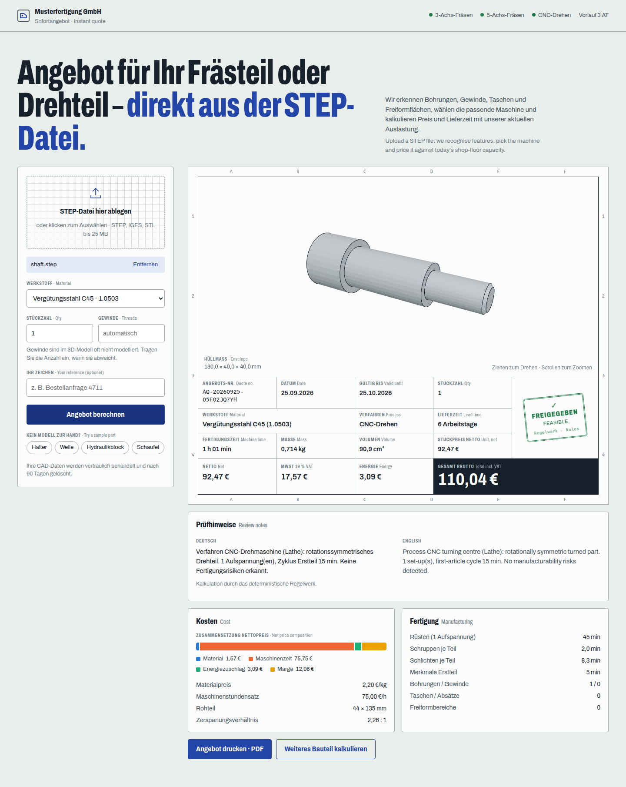
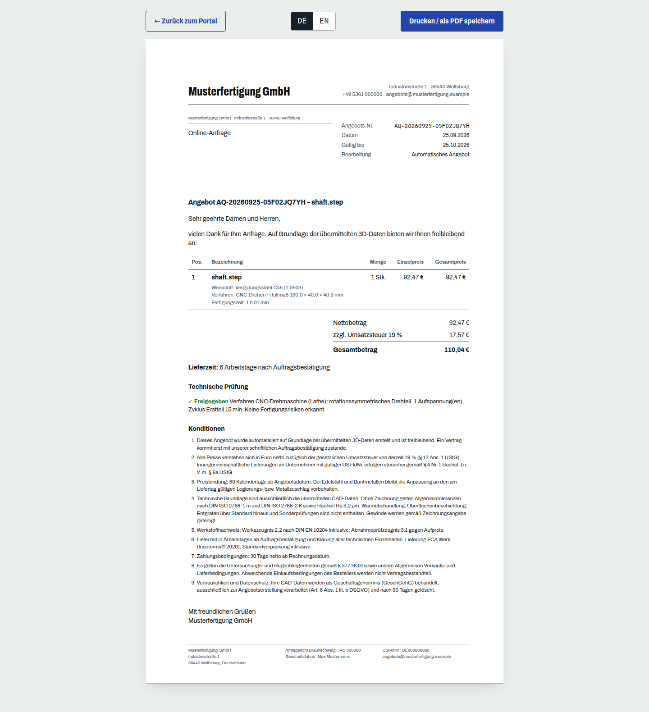

# Instant Quoting Engine · Sofortangebot für CNC-Lohnfertiger

**Upload a STEP file and get a VAT-compliant quote in seconds.** An AI micro-service for German
contract manufacturers (*Mittelstand*). It analyses the 3D geometry with OpenCascade, picks the
right machine against live shop-floor availability, calculates production time, lead time and price
cent-exactly, and has Claude review the result like a senior estimator (*Kalkulator*).



```
[ Frontend: Next.js ] ──► [ Backend: FastAPI ] ──► [ Python CAD Parser (OpenCascade) ]
                                  │
                                  ▼
                        [ Anthropic Claude API ]  ── guarded by a deterministic costing kernel
```

## What it does

| | |
|---|---|
| **CAD analysis** | STEP / IGES / STL → volume, area, bounding box, holes, threads (ISO 261 tap drills), pockets, free-form surfaces, turnability, machining directions, smallest hole/radius, hole L/D |
| **Machine selection** | Free-form or multi-sided → `CNC_5_Axis`, rotational → `Lathe`, prismatic → `CNC_3_Axis`, with work-envelope checks. A busy machine gives *Capacity Delay* +5 business days |
| **Costing** | Set-up 45 min, removal from stock at material-specific rates, finishing by surface area, feature penalties (5/5/15/30 min), batch amortisation, energy surcharge, margin, **19 % MwSt**, all to the cent |
| **AI review** | Claude (`claude-opus-5`, structured outputs) chooses among pre-computed options, escalates risks and writes bilingual *Prüfhinweise*. A guardrail re-derives every euro, so a model can never invent a price |
| **German compliance** | Freibleibend offer, ISO 2768-mK, EN 10204, Incoterms® 2020 FCA, § 377 HGB, DSGVO/GeschGehG, printable **DIN 5008** letter with the **§ 35a GmbHG** company details |
| **Shop integration** | `PUT /api/v1/factory` takes machine availability, backlog, rates and material prices from your MES/ERP (e.g. the [Industrie 4.0 telemetry gateway](https://github.com/PawanShetty-9/industrie40-telemetry-gateway)). `POST /api/v1/engine/evaluate` exposes the raw engine contract |
| **Production-ready** | Sandboxed CAD parsing, rate limiting, API keys, security headers, non-root read-only containers, auto-HTTPS (Caddy), CI, GHCR images, 64 tests |

## Quick start

**Docker (full stack with HTTPS):**

```bash
cp .env.example .env          # optional: set ANTHROPIC_API_KEY, QUOTE_ADMIN_API_KEY, company data
docker compose up -d --build
open https://localhost        # Caddy's local CA; set SITE_ADDRESS=your.domain for Let's Encrypt
```

**Local development:**

```bash
# Backend (Python 3.12)
cd backend
python3.12 -m venv .venv && . .venv/bin/activate
pip install -r requirements-dev.txt
uvicorn app.main:app --reload --port 8000          # http://localhost:8000/docs
pytest                                             # 64 tests: parser, rules, costing, AI guardrail, API

# Frontend (Node 22)
cd frontend
npm install
NEXT_PUBLIC_API_BASE_URL=http://localhost:8000 npm run dev   # http://localhost:3000
```

Without `ANTHROPIC_API_KEY` the deterministic rules engine answers on its own. Add the key and every
quote is additionally reviewed by Claude.

**Try it:** click a sample part in the portal (*Halter*, *Welle*, *Hydraulikblock*, *Schaufel*),
or:

```bash
curl -F file=@samples/bracket.step -F material=AL_6082_T6 -F quantity=10 localhost:8000/api/v1/quotes
```

## The engine contract

`POST /api/v1/engine/evaluate` (header `X-API-Key`) implements the specification verbatim.
[`cad_metadata`, `factory_status`, `cost_vectors`](samples/example_engine_input.json) go in, and
[exactly this JSON](samples/example_engine_output.json) comes out:

```json
{
  "quote_id": "AQ-20260925-EXAMPLE001",
  "feasibility": "Feasible",
  "feasibility_notes": "DE: Verfahren 3-Achs-Vertikal-Bearbeitungszentrum (CNC_3_Axis): prismatisches Frästeil. … | EN: Process 3-axis vertical machining centre (CNC_3_Axis): prismatic milled part. …",
  "selected_process": "CNC_3_Axis",
  "estimated_production_time_hours": 2.15,
  "cost_breakdown": {
    "material_cost_eur": 4.11,
    "machining_cost_eur": 182.75,
    "energy_surcharge_eur": 7.47,
    "net_total_eur": 223.48,
    "vat_19_eur": 42.46,
    "gross_total_eur": 265.94
  },
  "recommended_lead_time_days": 6
}
```

The worked calculation behind these numbers is in [docs/COST_MODEL.md](docs/COST_MODEL.md#9-worked-example-aluminium-bracket-samplesbracketstep).

## Documentation

| Document | Content |
|---|---|
| [docs/SCOPE.md](docs/SCOPE.md) | Product scope: problem, personas, KPIs, in/out of scope, NFRs, risks, roadmap, acceptance criteria |
| [docs/COST_MODEL.md](docs/COST_MODEL.md) | Every number and its source: German machine rates, LME/alloy-surcharge material prices, BDEW energy prices, removal rates, worked example, calibration |
| [docs/ARCHITECTURE.md](docs/ARCHITECTURE.md) | Components, request flow, AI guardrail, sandboxing, data protection |
| [docs/API.md](docs/API.md) | Endpoints, contract JSON, MES/ERP integration |
| [docs/DEPLOYMENT.md](docs/DEPLOYMENT.md) | On-prem Docker, Render (EU), Vercel + container host, configuration, go-live checklist |

A generated sample quote is included as [docs/img/sample-quote.pdf](docs/img/sample-quote.pdf).

<details>
<summary>Printable quote (DIN 5008, DE/EN)</summary>



</details>

## Kurzfassung (Deutsch)

Der Kunde lädt eine STEP-Datei hoch. Der Dienst erkennt Bohrungen, Gewinde, Taschen und
Freiformflächen und wählt die Maschine (3-Achs, 5-Achs, Drehen) unter Berücksichtigung der aktuellen
Verfügbarkeit. Er kalkuliert Fertigungszeit, Lieferzeit sowie Netto-, MwSt- und Bruttopreis
centgenau und erzeugt ein zweisprachiges, druckfertiges Angebot nach DIN 5008. Claude prüft jede
Kalkulation wie ein erfahrener Kalkulator; alle Beträge werden jedoch vom deterministischen
Rechenkern verifiziert. Die CAD-Datei selbst verlässt nie den Server.

> **Hinweis:** Stundensätze, Materialpreise und die Vertragstexte sind recherchierte
> Vorgabewerte bzw. Vorlagen. Vor dem Produktivbetrieb bitte mit eigenen Werten kalibrieren und die
> Konditionen juristisch prüfen lassen.

## License

MIT, see [LICENSE](LICENSE).
